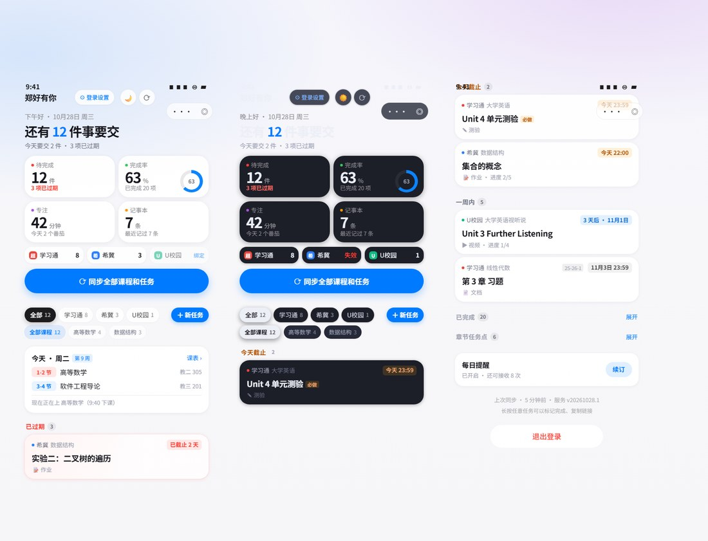
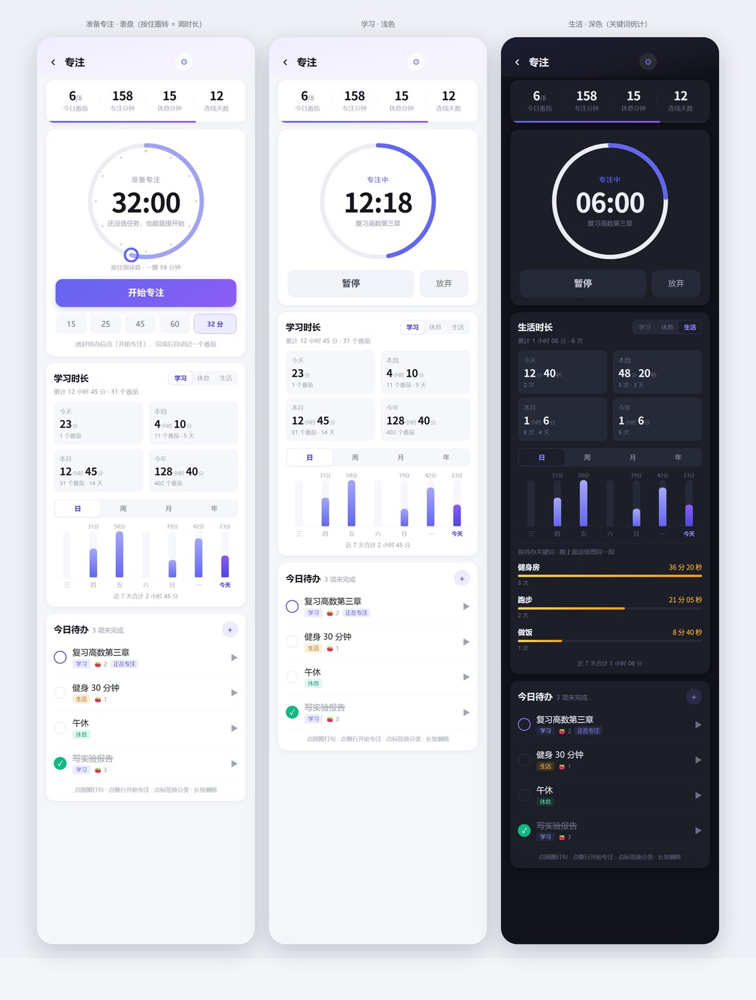

# 课业看板 · StudyHub

把分散在 **学习通 / 希冀(Educoder) / U校园 / 智慧树 / 雨课堂 / 中国大学MOOC** 六个平台的待办任务，聚合成一张按截止时间排序的清单。

微信小程序（原生，无第三方框架）+ 云开发（云函数 + 云数据库），个人独立完成。



---

## 为什么做这个

一门课一个平台，六门课六个 App。真正的问题不是"没有日历"，而是**你不知道这周到底要交什么**——得挨个登录、挨个翻。

这个项目把六处任务拉到一张清单里，按「过期 / 今天 / 一周内 / 章节 / 已完成」分组，回答一个问题：**还有几件事要交，最急的是哪件。**

## 功能

| 模块 | 说明 |
|---|---|
| 任务聚合 | 六平台统一模型，按截止时间排序，学期 / 平台 / 课程三层筛选 |
| 自动同步 | 云函数定时触发器每日 21:30 全量同步，订阅消息推送提醒 |
| 账号绑定 | 扫码登录、统一认证 CAS、AES 密码登录三种方式；内网平台支持真机直连 |
| 课表 | 周网格视图，支持粘贴导入 / 手动添加 |
| 记事本 | 宫格 / 列表双视图 + 搜索 + 置顶 + 自动保存 |
| 专注 | 番茄钟圆环（可拖成表盘），学习 / 休息 / 生活时长日周月年统计 |
| 主题 | 浅色 / 深色双主题，跟随系统或手动切换 |



## 架构

```
小程序（原生）
├── pages/            9 个页面：首页 / 详情 / 登录 / 账号 / 课表 / 记事本 / 便签 / 专注
├── utils/            18 个模块：api / model / auth / syncall / relogin / theme / semester ...
└── 云开发调用         wx.cloud.callFunction → 单一云函数
        │
云函数 studyHub（Node 18）
├── adapters/         六平台适配器：统一 login / sync / parse 三个接口
│   ├── chaoxing.js   学习通（Cookie + 扫码 + 作业/章节双路解析）
│   ├── educoder.js   希冀（校园内网 IP，需真机直连或本地代理）
│   ├── unipus.js     U校园（WebSocket 收扫码事件 + 长连接）
│   ├── zhihuishu.js / yuketang.js / icourse163.js
├── lib/              http / store / semester / permissions / secret / qrlogin
└── 云数据库          users · accounts · tasks · notes · timetables
```

**适配器契约**：新增一个平台只需实现 `login / sync / parse` 一个文件，注册到 `adapters/index.js`，前端与云端数据层零改动。

## 工程上做过的几件事

**1. 去重：一条作业被抓成两条**

超星把同一个作业在「未交」「已交」两个区块各渲染一次，两处 `workId` 还不同，于是库里并存一条 `todo` 和一条 `done`。用户交完作业，首页永远挂着一条要交。

判定规则：同平台 + 同课程 + 同标题，**只要存在一条已完成**，其余全部视为分身丢弃，不看截止时间（两个区块渲染的截止时间经常对不上）；全是未完成时才卡时间窗口，避免把「小测1 / 小测1（补考）」这种同名真作业吞掉。前后端各一份同规则实现——云端负责不写重复，前端负责兜住旧版本。

**2. 状态解析：不能依赖固定 HTML 结构**

平台改版后 `<span>作业状态：</span><strong>待批阅</strong>` 会变成 `<span class="status">已完成</span>` 或纯文本。做法是截取「状态：」后 140 字 → 剥标签 → 按词表判定，先排 `未通过 / 待重做 / 被打回`（否则「未通过」里的「通过」会被误判成已完成）。

**3. 登录态失效要主动说，不能让用户猜**

凭据错误、网络超时、接口变更三类失败分开处理，只有凭据类才提示「重新登录」——超时和 502 时不提示，因为重填密码也没用，只会让用户怀疑自己记错密码。账号页提供「状态诊断」，直接抓取平台页面并回显**状态原文**，用来区分是平台没更新还是解析漏了。

**4. 离线测试体系**

44 个纯 Node 测试文件、1600+ 项断言，**零依赖、全离线**。用 stub 替换 `wx / Page / getApp`，把 Page 配置对象直接实例化，喂假数据跑数据装配，断言渲染数据而不依赖 DOM —— 不打开开发者工具也能回归。

其中包含静态检查：WXML 条件链完整性（`wx:elif` 前夹注释会静默失效）、层叠陷阱（`position:fixed; z-index:0` 的整屏层会盖住所有未定位元素）、`rpx` 与 `calc` 兼容性。

## 目录

```
study-hub/
├── miniprogram/              小程序：9 个页面 + utils（主题 / 同步 / 登录态判定）
├── cloudfunctions/studyHub/  云函数：6 个平台适配器 + 数据层
├── test/                     44 个离线测试套件（stub 小程序运行时，无需真机）
├── localserver/              本地代理，用于内网平台的真机联调
├── docs/
│   ├── ARCHITECTURE.md       架构与数据流详解
│   ├── DEPLOY.md             部署手册
│   ├── prototypes/           各轮 UI 方案的静态预览页（浏览器直接打开）
│   └── images/               展示截图
├── tools/                    预览页与样式生成脚本（把 wxss 的 rpx 折半成 px）
└── project.config.json       微信开发者工具项目配置
```

## 本地运行

```bash
git clone <this-repo>
cd study-hub
```

1. 微信开发者工具导入 `miniprogram/`，填入自己的 AppID
2. 开通云开发，新建环境
3. 复制配置（仓库里只有示例值）
   ```bash
   cp miniprogram/env.example.js miniprogram/env.js
   # 填 CLOUD_ENV

   cp cloudfunctions/studyHub/lib/secret.local.example.js cloudfunctions/studyHub/lib/secret.local.js
   # 填一个随机字符串（换掉会导致已存账号需重新绑定）
   ```
4. 右键 `cloudfunctions/studyHub` → 上传并部署（云端安装依赖）
5. 云数据库建集合：`users` `accounts` `tasks` `notes` `timetables`

详细步骤见 [docs/DEPLOY.md](docs/DEPLOY.md)，架构细节见 [docs/ARCHITECTURE.md](docs/ARCHITECTURE.md)。

**不建环境只想看界面**：直接浏览器打开 `preview.html`、`preview-index-magnet.html`、`preview-tomato.html`，静态还原，带模拟数据。

## 免责声明

- 本项目仅用于**聚合本人账号**的任务数据，复用的是用户自己在平台上的登录态，只读不写，不绕过任何鉴权、不破解验证码。
- 未做任何商业化使用，不存储他人数据，账号凭据仅加密保存在用户自己的云环境内。
- 平台接口随时可能变更，同步失败属正常现象；使用前请遵守各平台的服务条款。
